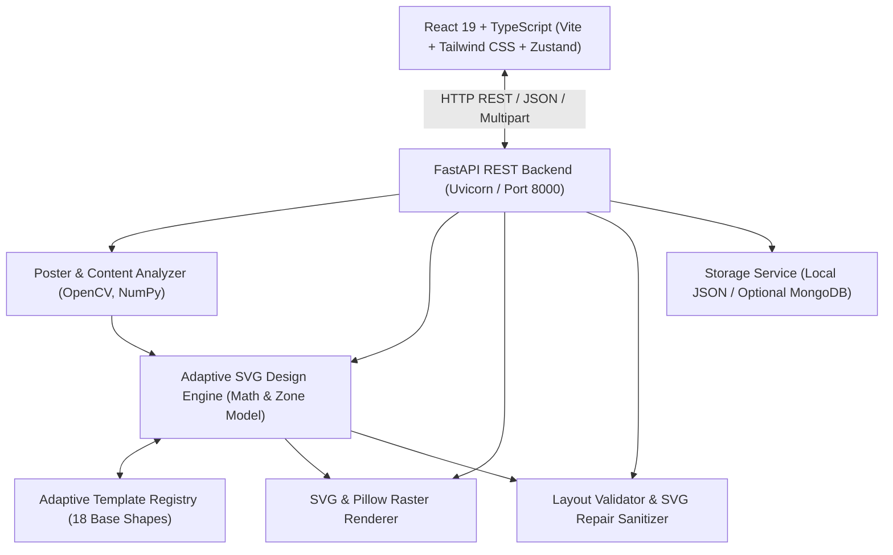

# System Architecture — AI Footer Designer

## 1. High-Level System Architecture

## 2. Adaptive SVG Design Engine Architecture

Instead of serving static, downloaded SVGs with rigid dimensions, the **Adaptive SVG Engine** builds mathematical, zone-based vector templates.

### A. Template Configuration Specification
Each template adheres to a declarative schema:
- **`viewBox` Coordinates**: Normalized coordinate grid that stretches responsively.
- **Dynamic Dimensioning**: Height dynamically derived from poster aspect ratio:
  - **Portrait (9:16)**: Height ratio `0.11 - 0.14` to preserve artwork headroom.
  - **Square (1:1)**: Height ratio `0.14 - 0.17` for balanced visual weight.
  - **Landscape (16:9)**: Height ratio `0.18 - 0.24` utilizing horizontal breathing room.
- **Configurable Path Generators**: Parametric SVG curves (waves, diagonals, arches, notches) where curve amplitudes are clamped so they never distort when widths scale from 720px to 4K (3840px).
- **Content Zones**:
  - `identity_zone`: Logo + Brand Name + Tagline.
  - `contacts_zone`: Phone, WhatsApp, Email, Website in auto-wrapping column matrices.
  - `actions_zone`: CTA Button, Address, QR Code, Social Badges.
  - `profile_zone`: Avatar placement with circle, arch, rounded, or square clip-paths.
- **Responsive Stacking Rules**:
  - Automatically collapses from 3-4 columns to 2 columns on tall narrow mobile banners.
  - Prevents text truncation through resolution-aware font clamping.
  - Preserves exact 1:1 and natural logo aspect ratios regardless of footer height.

### B. SVG Sanitizer & Repair Pipeline
When arbitrary SVG artwork is provided:
1. Extracts root `viewBox`, attributes, and path commands.
2. Removes hardcoded pixel widths/heights that break responsiveness.
3. Injects scalable `preserveAspectRatio="none"` for backgrounds and `preserveAspectRatio="xMidYMid meet"` for logos.
4. Auto-converts fixed-dimension vector artwork into responsive vector shapes or falls back cleanly to the closest mathematical template.

## 3. Data Flow
1. **User Upload**: User uploads poster + brand details in frontend.
2. **Analysis Request**: Frontend sends multipart image to `POST /api/analyze`.
3. **Vision Processing**: OpenCV extracts dominant colors, bottom area brightness, and safe margin.
4. **Adaptive Generation**: Engine selects matching templates from the registry, applies poster dimensions, content density, and brand colors to construct responsive `FooterDesign` models.
5. **Validation & Quality Scoring**: Validates bounding boxes, WCAG contrast, and zone containment.
6. **Live Interactive Editing**: SVG renders directly into the browser canvas with transform matrix zoom/pan and properties editing.
7. **Export**: Pillow and vector serializers produce PNG, JPG, SVG, and PDF exports.

## 4. Logo Color Extraction & Adaptive Palette Engine

The **Logo Color Extraction & Palette Engine** automatically derives high-contrast brand styling directly from an uploaded logo without external APIs:

### A. Color Extraction Algorithm (Pillow + Color Clustering)
1. **Alpha Channel & Background Filtering**: Transparent pixels (`alpha < 25`) and near-uniform canvas borders are excluded so transparency does not skew clustering.
2. **K-Means Clustering**: Clusters remaining pixels into distinct color centroids with percentage weighting.
3. **Role Categorization**:
   - **Primary Brand Color**: The most prominent chromatic centroid.
   - **Secondary Brand Color**: The secondary harmonious centroid (distinct hue/luminance).
   - **Accent Color**: High-saturation or distinct focal hue.
   - **Light Shade**: Tinted surface color with high luminance (>0.90) for clean light modes.
   - **Dark Shade**: Deep rich tone with low luminance (<0.15) tinted with the brand's primary hue.

### B. Contrast & Readability Assurance (WCAG 2.1)
- For every color application, relative luminance is calculated ($L = 0.2126R + 0.7152G + 0.0722B$).
- Text elements are automatically set to high-contrast white/light or dark/slate based on background luminance, ensuring WCAG AA minimum 4.5:1 readability.
- Badges, dividers, and icon tints automatically pair with the accent/secondary colors.

### C. Color Scheme Variations
Generates 5 distinct professional styling modes from the same logo palette:
1. **Bold Primary**: Primary brand background with accent highlights.
2. **Dark Luxury**: Deep dark shade background with vibrant brand highlights and crisp white typography.
3. **Clean Light / Minimalist**: Crisp light tint background with dark brand typography and vibrant accents.
4. **Gradient Duo**: Smooth linear gradient from primary to secondary brand colors.
5. **Accent Pop**: Deep surface with glowing accent badges and borders.
